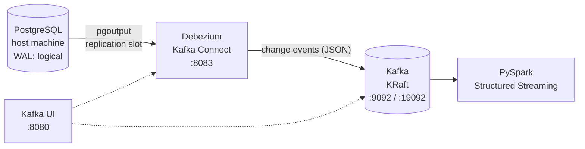

# CDC Pipeline: PostgreSQL → Debezium → Kafka → Spark Structured Streaming

A local **Change Data Capture (CDC)** pipeline that captures every `INSERT`, `UPDATE` and `DELETE` from PostgreSQL in near real time, publishes the changes to Kafka with Debezium, and consumes them with PySpark Structured Streaming.

The source is a set of Northwind (`nw1_*`) tables in the `bronze` schema of a PostgreSQL database called `CDC`.

---

## Architecture



| Step | What happens |
|---|---|
| 1 | Every committed change is written to the PostgreSQL **WAL** (Write-Ahead Log, like Oracle redo logs). |
| 2 | **Debezium** reads the WAL through a **replication slot** and the `pgoutput` plugin, filtered by a **publication**. |
| 3 | Each change becomes a JSON event (`before` / `after` / `op`) in a Kafka topic named `postgres.bronze.<table>`. |
| 4 | **Spark** reads the topics as a stream, parses the Debezium envelope and processes each micro-batch. |

Kafka decouples the source from the consumers: if Spark is stopped, Debezium keeps writing, and Spark catches up from its checkpoint later.

---

## Tech stack

| Component | Version / image | Role |
|---|---|---|
| PostgreSQL | 15+ (runs on the host) | Source database |
| Apache Kafka | `apache/kafka:3.9.1` (KRaft, no ZooKeeper) | Event storage |
| Debezium Connect | `quay.io/debezium/connect:3.1` | CDC source connector |
| Kafka UI | `ghcr.io/kafbat/kafka-ui:latest` | Web UI for topics and connectors |
| PySpark | 3.5.x / 4.x + `spark-sql-kafka` | Stream consumer |
| Docker Compose | v2 | Runs Kafka, Debezium and Kafka UI |

---

## Repository structure

```
.
├── docker-compose.yml        # Kafka + Debezium Connect + Kafka UI
├── postgres-connector.json   # Debezium PostgreSQL connector config
├── spark_cdc_stream.py       # PySpark Structured Streaming consumer
└── README.md
```

---

## Prerequisites

- Linux host (tested on Ubuntu) with Docker and Docker Compose
- PostgreSQL 15+ installed on the host, with a database `CDC` and a `bronze` schema
- Python 3.10+, Java 11/17 and `pyspark` (`pip install pyspark`)
- `curl` and `jq`

---

## Step 1: Configure PostgreSQL (WAL)

The WAL always exists; we only raise its level to `logical`, so it records row-level changes that Debezium can decode.

Run as a superuser:

```sql
ALTER SYSTEM SET wal_level = 'logical';
ALTER SYSTEM SET max_replication_slots = 10;
ALTER SYSTEM SET max_wal_senders = 10;
ALTER SYSTEM SET listen_addresses = '*';

-- Safety net: a stopped connector can't make the slot retain more than 10 GB of WAL
ALTER SYSTEM SET max_slot_wal_keep_size = '10GB';
```

Allow Docker containers to connect. Add this line to `pg_hba.conf` (find it with `SHOW hba_file;`):

```
host    all    debezium    172.16.0.0/12    scram-sha-256
```

Restart PostgreSQL (`wal_level` requires a restart, not a reload):

```bash
sudo systemctl restart postgresql
```

Verify:

```sql
SHOW wal_level;               -- logical
SHOW max_slot_wal_keep_size;  -- 10GB
```

---

## Step 2: Debezium user, privileges and publication

Run on the `CDC` database:

```sql
-- User with the REPLICATION attribute
DO $$
BEGIN
  IF NOT EXISTS (SELECT 1 FROM pg_roles WHERE rolname = 'debezium') THEN
    CREATE ROLE debezium WITH LOGIN REPLICATION PASSWORD 'debezium';
  ELSE
    ALTER ROLE debezium WITH LOGIN REPLICATION PASSWORD 'debezium';
  END IF;
END $$;

-- SELECT is needed for the initial snapshot
GRANT CONNECT ON DATABASE "CDC" TO debezium;
GRANT USAGE ON SCHEMA bronze TO debezium;
GRANT SELECT ON ALL TABLES IN SCHEMA bronze TO debezium;
ALTER DEFAULT PRIVILEGES IN SCHEMA bronze GRANT SELECT ON TABLES TO debezium;

-- Publication: which tables are streamed
DROP PUBLICATION IF EXISTS dbz_publication;

CREATE PUBLICATION dbz_publication FOR TABLE
  bronze.nw1_customers, bronze.nw1_employees, bronze.nw1_products,
  bronze.nw1_categories, bronze.nw1_suppliers, bronze.nw1_shippers,
  bronze.nw1_orders, bronze.nw1_order_details
WITH (publish_via_partition_root = true);
```

> **Why `publish_via_partition_root = true`?** The bronze tables are RANGE-partitioned by `load_date` (`_2026`, `_2027`, `_default`). Without this option, changes are published under the partition name (`nw1_shippers_2026`), and Debezium filters them out because `table.include.list` contains the parent name.

**Optional:** full `before` image on UPDATE/DELETE. On partitioned tables this must be set on every partition:

```sql
DO $$
DECLARE r record;
BEGIN
  FOR r IN
    SELECT n.nspname, c.relname
    FROM pg_class c JOIN pg_namespace n ON n.oid = c.relnamespace
    WHERE n.nspname = 'bronze' AND c.relname LIKE 'nw1\_%' AND c.relkind IN ('r', 'p')
  LOOP
    EXECUTE format('ALTER TABLE %I.%I REPLICA IDENTITY FULL', r.nspname, r.relname);
  END LOOP;
END $$;
```

Verify:

```sql
SELECT rolname, rolreplication FROM pg_roles WHERE rolname = 'debezium';
SELECT * FROM pg_publication_tables WHERE pubname = 'dbz_publication';  -- parent tables, not partitions
```

---

## Step 3: Start Kafka, Debezium and Kafka UI

```bash
docker compose up -d
docker compose ps          # kafka must be (healthy)
```

| Service | Port | Notes |
|---|---|---|
| `kafka` | `9092` (host), `19092` (inside Docker) | Single-node KRaft broker + controller |
| `debezium-connect` | `8083` | Kafka Connect REST API |
| `kafka-ui` | `8080` | http://localhost:8080 |

**Two listeners:** containers (Debezium, Kafka UI) use `kafka:19092`; anything running on the host (Python, Spark) uses `localhost:9092`.

Check that the PostgreSQL connector plugin is available:

```bash
curl -s localhost:8083/connector-plugins | jq -r '.[].class' | grep -i postgres
# io.debezium.connector.postgresql.PostgresConnector
```

---

## Step 4: Register the connector

```bash
curl -X POST -H "Content-Type: application/json" \
  --data @postgres-connector.json localhost:8083/connectors

curl -s localhost:8083/connectors/postgres-cdc-connector/status | jq
# connector and task: RUNNING
```

Key settings in `postgres-connector.json`:

| Setting | Value | Why |
|---|---|---|
| `database.hostname` | `host.docker.internal` | PostgreSQL runs on the host, not in Docker |
| `plugin.name` | `pgoutput` | Built-in logical decoding plugin (no extension needed) |
| `slot.name` | `debezium_slot` | Replication slot; Debezium creates it on first start |
| `publication.name` / `autocreate.mode` | `dbz_publication` / `disabled` | We created the publication ourselves in Step 2 |
| `topic.prefix` | `postgres` | Topics become `postgres.bronze.<table>` |
| `decimal.handling.mode` | `double` | `NUMERIC` arrives as a number (use `string`/`precise` for money in production) |
| `*.converter.schemas.enable` | `false` | Plain JSON payload without the embedded schema block |
| `tombstones.on.delete` | `false` | No extra `null` message after each delete |
| `heartbeat.interval.ms` | `10000` | Keeps the slot's LSN moving when the captured tables are idle |

> The PostgreSQL connector does **not** need `schema.history.internal.*` settings. Those are for MySQL, SQL Server and Oracle.

To update the config of an existing connector, `PUT` only the `config` object:

```bash
jq '.config' postgres-connector.json > config-only.json
curl -X PUT -H "Content-Type: application/json" \
  --data @config-only.json localhost:8083/connectors/postgres-cdc-connector/config
```

---

## Step 5: Verify the events

List topics:

```bash
docker compose exec kafka /opt/kafka/bin/kafka-topics.sh \
  --bootstrap-server localhost:19092 --list | grep postgres
```

A topic is created on the **first event** for a table, so empty tables have no topic yet.

Watch a topic live:

```bash
docker compose exec kafka /opt/kafka/bin/kafka-console-consumer.sh \
  --bootstrap-server localhost:19092 \
  --topic postgres.bronze.nw1_shippers --from-beginning
```

Make a change in PostgreSQL (and **commit**; Debezium only sees committed transactions):

```sql
INSERT INTO bronze.nw1_shippers (shipperid, companyname, phone, load_date)
VALUES (9001, 'Test Express', '+995 555 222 222', current_date);
COMMIT;

UPDATE bronze.nw1_shippers SET phone = '+995 555 111 111' WHERE shipperid = 9001;
COMMIT;

DELETE FROM bronze.nw1_shippers WHERE shipperid = 9001;
COMMIT;
```

### Event format

```json
{
  "before": null,
  "after": {"shipperid": 9001, "companyname": "Test Express", "phone": "+995 555 222 222", "load_date": 20764},
  "source": {"db": "CDC", "schema": "bronze", "table": "nw1_shippers", "lsn": 22426192816, "txId": 38697, "...": "..."},
  "op": "c",
  "ts_ms": 1793341546125
}
```

| `op` | Meaning | `before` | `after` |
|---|---|---|---|
| `r` | Snapshot read (initial load) | `null` | row |
| `c` | Insert | `null` | new row |
| `u` | Update | `null` (or old row with `REPLICA IDENTITY FULL`) | new row |
| `d` | Delete | key (or full row with `REPLICA IDENTITY FULL`) | `null` |

Type encoding to keep in mind:

- `DATE` → days since 1970-01-01 (`20764` = 2026-11-07)
- `TIMESTAMP` → microseconds since epoch
- `NUMERIC` → double (because of `decimal.handling.mode`)

---

## Step 6: Consume with Spark Structured Streaming

Spark acts as a regular Kafka consumer: on every trigger it pulls the new offsets, parses the JSON and processes the micro-batch. The progress (offsets) is stored in a **checkpoint** folder, so a restart continues where it stopped.

```bash
python spark_cdc_stream.py
```

How `spark_cdc_stream.py` is organized:

- **One file for all tables.** Each table is described once in the `TABLES` dict (primary key + columns in Spark DDL). Adding a table is one new entry.
- **`TABLES_TO_RUN`** chooses which tables to start.
- **One stream + one checkpoint per table** (`./checkpoints/<table>`), so a failure in one table doesn't stop the others.
- **`subscribePattern`** instead of `subscribe`, so a stream starts even if its topic doesn't exist yet and picks it up once the first event arrives.
- **Automatic type conversion:** columns declared as `DATE` / `TIMESTAMP` are converted from Debezium's day / microsecond numbers.
- **`failOnDataLoss = false`**: offsets removed by Kafka retention don't crash the stream.

On the first run the Kafka connector package is downloaded from Maven (internet needed). Spark reads from `localhost:9092`.

To re-read a table from the beginning, delete its checkpoint:

```bash
rm -rf ./checkpoints/nw1_shippers
```

> If a column comes out as `null`, the type in `TABLES` probably doesn't match the PostgreSQL type. `from_json` does not raise an error on a mismatch.

---

## Daily operations

| Action | Command | Kafka data + connector |
|---|---|---|
| Stop | `docker compose stop` | kept |
| Start | `docker compose up -d` | kept, Debezium resumes from its stored LSN |
| Remove containers | `docker compose down` | kept (volume survives) |
| Full reset | `docker compose down -v` | **deleted**: register the connector again |

After `up -d`, just check the status; re-registering an existing connector returns `409 already exists`, which is fine:

```bash
curl -s localhost:8083/connectors/postgres-cdc-connector/status | jq
```

Restart a failed connector:

```bash
curl -X POST "localhost:8083/connectors/postgres-cdc-connector/restart?includeTasks=true"
```

### Watch the replication slot

While the connector is stopped, its slot keeps WAL on disk:

```sql
SELECT slot_name, database, active,
       pg_size_pretty(pg_wal_lsn_diff(pg_current_wal_lsn(), restart_lsn)) AS retained_wal
FROM pg_replication_slots;
```

If you stop the project for a long time, remove the connector and the slot:

```bash
curl -X DELETE localhost:8083/connectors/postgres-cdc-connector
```

```sql
SELECT pg_drop_replication_slot('debezium_slot');
```

### Kafka retention

Kafka keeps messages for 7 days by default. To keep them longer in this lab, add to the `kafka` service:

```yaml
KAFKA_LOG_RETENTION_HOURS: 720   # 30 days
```

---

## Troubleshooting (lessons learned)

| Symptom | Cause | Fix |
|---|---|---|
| Connector `RUNNING`, but no data topics | Tables are empty; snapshot logs show `Finished exporting 0 records` | Insert a row; the topic is created on the first event |
| Insert done, nothing arrives | Transaction not committed (IDE in manual-commit mode) | `COMMIT;` |
| Nothing arrives for partitioned tables | Publication publishes partition names | Recreate it `WITH (publish_via_partition_root = true)` |
| `docker-compose.yml` fails to start | Duplicated services / broken lines after copy-paste | Keep one definition per service; validate with `docker compose config` |
| Spark: `UnknownTopicOrPartitionException` | `subscribe` on a topic that doesn't exist yet | Use `subscribePattern` |
| Database "CDC" not found | PostgreSQL names are case-sensitive | Check `\l`; use the exact name |
| Disk filling up with WAL | Inactive replication slots from old projects | Drop unused slots with `pg_drop_replication_slot` |
| Console consumer creates an empty topic | Kafka auto-creates topics on subscribe | Harmless; it doesn't mean Debezium sent anything |

---

## Roadmap

- [x] PostgreSQL logical replication + publication
- [x] Debezium → Kafka (KRaft) in Docker Compose
- [x] Spark Structured Streaming → console
- [ ] Spark `foreachBatch` → dedup by PK / latest `lsn` → `MERGE` into a target (PostgreSQL or Delta Lake)
- [ ] Add CNK1 (Chinook) and AW22 (AdventureWorks) tables
- [ ] Orchestration / monitoring
